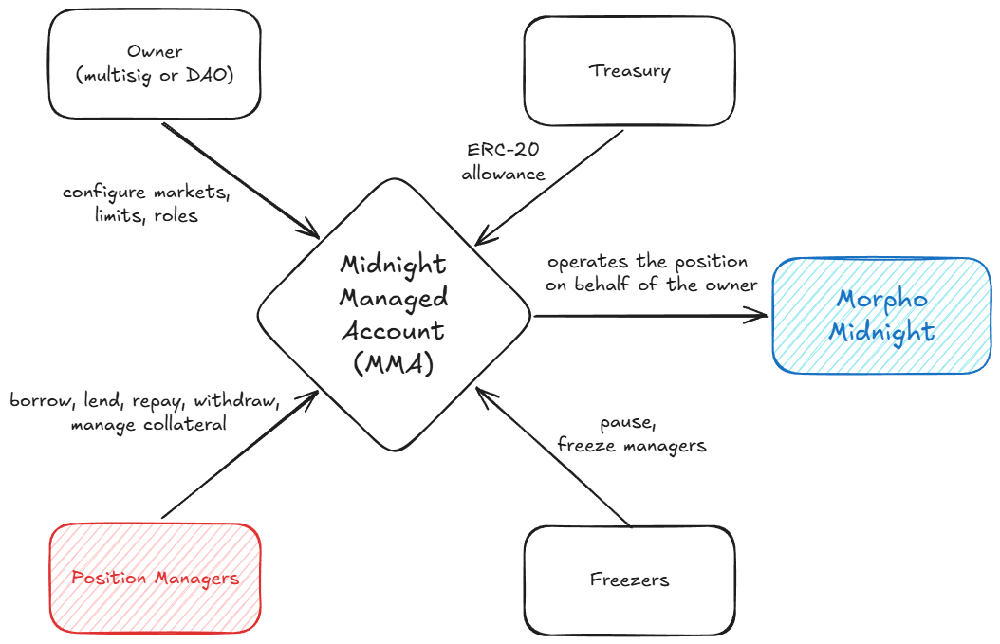

# Midnight Managed Account

A contract for delegating position management on [Morpho Midnight](https://github.com/morpho-org/midnight) without delegating control over funds.

Midnight's native authorization is all-or-nothing: an authorized address gets full control over the owner's Midnight state, including the ability to withdraw to arbitrary addresses. MMA is the missing scoping layer. The owner authorizes MMA on Midnight, and MMA exposes a restricted set of actions to operators, each checked against owner-configured markets, rate limits, and withdrawal destinations.



## Roles

- **Owner** holds the Midnight positions and sets the rules: enabled markets, rate bounds, debt caps, limits, operators. 
- **Operators** execute `borrow`, `lend`, `repay`, `withdraw` and collateral operations within those rules. They cannot change their own permissions or limits.
- **Freezers** can pause the account or disable an operator at any time, but cannot unpause, restore access, or configure anything.
- **Treasury** is a separate address holding liquid assets. It grants MMA an ERC-20 allowance; MMA pulls the exact amount just in time for paying operations. Revoking the allowance cuts off funding without touching position ownership.

The account deploys paused and with no limits configured, so everything is deny by default.

## Contracts

| File | Purpose |
|---|---|
| [`src/MidnightManagedAccount.sol`](src/MidnightManagedAccount.sol) | Operator entry points (`borrow`, `lend`, `withdraw`, `repay`, `supplyCollateral`, `withdrawCollateral`), treasury funding, and Midnight payment callbacks. |
| [`src/MidnightManagedAccountLimits.sol`](src/MidnightManagedAccountLimits.sol) | Owner/freezer configuration: pause, operators, per-market config, and the refilling limit mechanism. |
| [`src/LimitKeys.sol`](src/LimitKeys.sol) | Derives the `bytes32` keys that identify each limit. |

## Rate limits

Every limit is a refilling budget: a maximum capacity (`maxAmount`) and a refill rate (`refillPerSecond`). Operations consume capacity; it refills linearly up to the maximum:

```
available = min(balance + refillPerSecond * elapsed, maxAmount)
```

This bounds both the instant amount an operator can move and the throughput over time, with no fixed-window resets and no per-operation history. An unconfigured limit (zero `maxAmount`) denies the operation entirely, so receiver-keyed limits double as withdrawal allowlists.

Each operation checks its own set of limits, keyed as derived in [`LimitKeys.sol`](src/LimitKeys.sol):

| Operation | Configurable limits |
|---|---|
| `borrow` | per market, per market and operator, per loan token across markets, per market and receiver (assets sent out) |
| `lend` | per market, per market and operator, per loan token across markets |
| `withdraw` | per market and receiver |
| `repay` | per market |
| `supplyCollateral` | per market and collateral token |
| `withdrawCollateral` | per market, collateral token, and receiver |

On top of limits, each enabled market has a config:

- `maxDebt` is the maximum outstanding debt after a borrow;
- `maxBorrowRate` is the highest per-second borrow rate an operator may accept;
- `minLendRate` is the lowest per-second lend yield an operator may accept, net of fees.

## Treasury safety

Midnight collects payments through callbacks (`onBuy`, `onRepay`). Since MMA can spend the treasury's allowance, callbacks are strictly bound to the in-flight operation: before calling Midnight, MMA records the expected payment kind, market, and amounts in transient storage. A callback must come from the Midnight contract, match that expectation, and can be consumed only once; anything else reverts.

## Audits

The protocol has not been audited yet. Use at your own risk.
